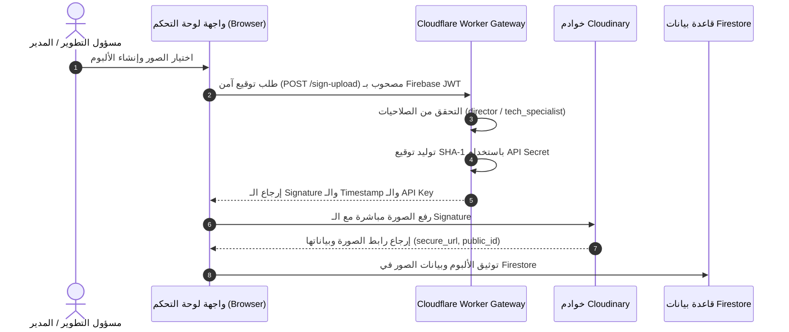

# دليل إعداد وتشغيل خدمة Cloudinary للوسائط المدرسية
## Digital School Ecosystem — Media & Gallery Architecture

يوفر هذا الدليل الخطوات التفصيلية لإعداد وربط منصة Cloudinary لتخزين وتسليم الصور وألبومات الأنشطة المدرسية بكفاءة عالية وبأعلى معايير الأمان المؤسسي.

---

### 1. المتطلبات والبيانات الأساسية
من لوحة تحكم [Cloudinary Console](https://cloudinary.com/console):
- **Cloud Name**: اسم السحابة الخاصة بالمؤسسة (مثال: `dse-school-cairo`).
- **API Key**: المفتاح العام للاستعلام والربط.
- **API Secret**: المفتاح السري المعتمد للتوقيع وتوليد الـ Signatures (يُحفظ **حصرًا** داخل خوادم Cloudflare Workers المشفرة، ولا يوضع إطلاقًا في المتصفح أو أكواد الواجهة الأمامية Client-side).

---

### 2. هيكل المجلدات المنظم (Folder Structure)
يتم تنظيم الصور تلقائياً حسب المدرسة والسنة والألبوم:
```text
schools/
└── {schoolId}/               # معرّف المدرسة (مثال: sch_cairo_sec_01)
    └── albums/
        └── {albumId}/        # معرّف الألبوم (مثال: alb_1762500000)
            ├── raw/          # الصور الأصلية
            └── covers/       # غلاف الألبوم المعتمد
```

---

### 3. إعدادات التحويل التلقائي (Delivery Transformations)
يتم طلب الصور من المتصفح عبر دالة `getOptimizedImageUrl` في [js/services/cloudinary-service.js](js/services/cloudinary-service.js) مع تطبيق التوليفات التالية:
- **`f_auto`**: اختيار الامتداد الأنسب للمتصفح تلقائياً (WebP أو AVIF لتوفير 70% من حجم الباندويث).
- **`q_auto`**: ضبط ذكاء جودة الصورة للحفاظ على نقاء الألوان وتخفيض الحجم.
- **`c_fill,g_auto`**: القص الموجه بالذكاء الاصطناعي على العناصر البصرية والوجوه لمنع تشويه الصور.
- **أبعاد الأغلفة المصغرة**: `w_600,h_400,c_fill`.
- **أبعاد العرض فائق النقاء**: `w_1400,c_limit`.

---

### 4. دورة الرفع الآمن الموقّع (Signed Upload Pipeline)


---

### 5. ضوابط الأمان والتحقق
1. **صلاحية الرفع**: محصورة حصرًا بمدير المدرسة (`director`) ومسؤول التطوير التكنولوجي (`tech_specialist`).
2. **أنواع الملفات المسموحة**: `image/jpeg`, `image/png`, `image/webp`.
3. **الحد الأقصى لحجم الصورة**: 10 ميجابايت كحد أقصى.
4. **اعتماد الرفع**: لا يوجد حفظ محلي بديل عند فشل Cloudinary؛ لا تظهر رسالة نجاح إلا بعد رجوع رابط `secure_url` من Cloudinary.
5. **حالة مؤقتة**: رابط الـWorker متوقف افتراضيًا بسبب كشف API Secret سابقًا. دوّر السر وأعد نشر الـWorker حسب [دليل إعداد Cloudflare Worker](CLOUDFLARE_WORKER_SETUP.md) قبل إعادة تفعيل الرفع.

